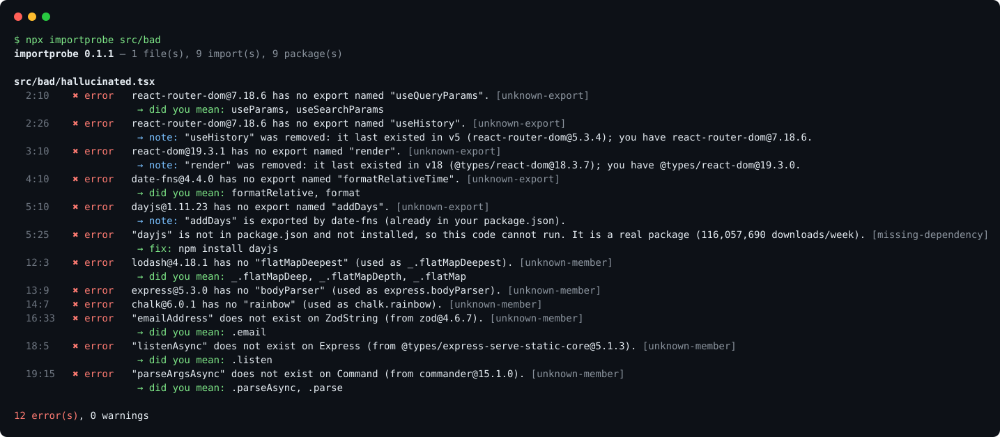

# importprobe

[](https://www.npmjs.com/package/importprobe)
[](https://github.com/KaanKaya17/importprobe/actions/workflows/ci.yml)
[](LICENSE)

**Catch what your AI coding agent made up — before it runs.**

AI assistants write code that is *almost* right: an import from a package that
doesn't exist, a function the package never exported, a method from a different
library or an older major version, a typo'd package name that an attacker
registered. importprobe checks every import and API call against the real package.



```bash
npx importprobe          # check the current project
npx importprobe init     # make your AI agent check its own code (Claude Code, Cursor, VS Code)
```

## What it checks

| Problem | Example | Rule |
|---|---|---|
| Package doesn't exist | `import x from 'axios-retry-pro'` | `unknown-package` |
| Typosquat or brand-new / barely used package | `expresss`, `loadsh`, a name registered last week | `suspicious-package` |
| Deprecated package | `request` | `deprecated-package` |
| Real package, not in package.json, not installed | `import { nanoid } from 'nanoid'` | `missing-dependency` |
| Works only by accident (transitive) | `import mime from 'mime-types'` | `undeclared-dependency` |
| Export doesn't exist | `import { formatRelative } from 'dayjs'` | `unknown-export` |
| Method doesn't exist — directly or **in a chain** | `axios.fetch()`, `z.string().emailAddress()`, `express().listenAsync()` | `unknown-member` |
| Entry point doesn't exist | `dayjs/plugin/relativeTimes` | `unknown-subpath` |
| Node built-ins | `node:paths`, `readJsonSync` from `node:fs` | `unknown-builtin`, `unknown-export` |
| Local files | missing file, wrong export name, default import of a named-only module | `missing-file`, `unknown-export`, `no-default-export` |

Works on `.js .jsx .ts .tsx .mjs .cjs` and the scripts of **`.vue`, `.svelte` and `.astro`** files.

And it explains *why*, so the fix is obvious:

- **"was removed: it last existed in v5"** / **"was added in v8"** — checks other majors of the package (or its `@types`).
- **"is exported by date-fns"** — the AI mixed up two libraries (your dependencies, Node built-ins, and a built-in index of ~100 popular packages).
- **"did you mean"** — closest real names. Suggested packages must themselves be established (≥ 1,000 downloads/week); deprecated ones are marked.

**It checks the real package without installing it.** When a package isn't
installed, importprobe downloads the published tarball, keeps only declaration /
JS / package.json files, and reads them with the TypeScript checker. Nothing from
the package is ever executed — no install scripts, no `require`.

Chained-call checks only report members missing from types that a **package's
own declaration files** define. Your project's types, augmentations
(`declare global`, `declare module`) and `tsconfig` `paths`/`types` are respected.

## Use it

```bash
npx importprobe                 # current folder
npx importprobe src/ app.tsx    # files or folders
npx importprobe --changed       # only files changed in git
npx importprobe --fast          # imports + direct members only, no network hints
npx importprobe --json          # for tools
npx importprobe --sarif > importprobe.sarif   # GitHub code scanning
```

Exit code `1` when errors are found (`--strict`: warnings too), `0` when clean.
In a monorepo each file is checked against its own nearest `package.json`.

### Let your AI agent check — and fix — its own code

```bash
npx importprobe init            # detects .claude / .cursor / .vscode
npx importprobe init claude cursor vscode --dry-run
```

`init` merges into your existing config files (it never drops your settings and
leaves files with comments untouched, printing what to add instead):

| Agent | What it adds |
|---|---|
| Claude Code | a `PostToolUse` hook in `.claude/settings.json` — after every file the agent writes, invented imports go straight back to the agent — plus the MCP server in `.mcp.json` |
| Cursor | the MCP server in `.cursor/mcp.json` |
| VS Code | the MCP server in `.vscode/mcp.json` |

<details><summary>Manual setup</summary>

Claude Code hook (`.claude/settings.json`):

```json
{
  "hooks": {
    "PostToolUse": [
      { "matcher": "Write|Edit|MultiEdit",
        "hooks": [{ "type": "command", "command": "npx -y importprobe hook" }] }
    ]
  }
}
```

MCP server, any client: command `npx`, args `["-y", "importprobe", "mcp"]`
(on native Windows: command `cmd`, args `["/c", "npx", "-y", "importprobe", "mcp"]`).

```bash
claude mcp add importprobe -- npx -y importprobe mcp
```
</details>

### MCP tools: look things up instead of guessing

| Tool | What the agent gets |
|---|---|
| `list_exports` | The real API of a package or built-in, with signatures; or the members of one export (methods, what a call returns, class instance members). Installed version, or any version from npm. |
| `check_package` | Does it exist? How old, how popular, deprecated? Similar real names if not. |
| `check_files` | Everything the CLI checks, as agent-ready feedback. |

importprobe is listed in the [MCP Registry](https://registry.modelcontextprotocol.io) as `io.github.KaanKaya17/importprobe`.

### GitHub Action

Annotates the pull request on the exact lines, writes a job summary, and can produce SARIF:

```yaml
- uses: KaanKaya17/importprobe@v0.1.1 # or pin the commit SHA
  with:
    path: src            # default: .
    fail-on: error       # error | warning | never
    sarif: importprobe.sarif   # optional
- uses: github/codeql-action/upload-sarif@v3   # optional: show in the Security tab
  if: always()
  with: { sarif_file: importprobe.sarif }
```

Outputs: `errors`, `warnings`. The action runs the importprobe code of the ref you
pinned; it does not download anything else at run time (except registry lookups).

## How it works

1. Pre-scans files for module specifiers (static, dynamic `import()`, `require`, re-exports).
2. For each package: is it declared? installed? on npm? how old, how popular, deprecated, a typo of a popular name?
3. Fetches declarations for packages that aren't installed (+ matching-major `@types/*`).
4. Builds one TypeScript program (with your project's `.d.ts` files and resolution settings)
   and asks the checker what each module really exports and what each value really has.
5. For misses, looks at other major versions, your other dependencies and a built-in index to explain them.

Exports inferred from plain-JavaScript packages (no types) can be incomplete, so
those findings are warnings, not errors.

## Cache and privacy

Only public registry endpoints are called (`registry.npmjs.org`, `api.npmjs.org`),
and only with package names — including names of the packages your code imports,
so private package names are sent too unless you use `--offline`. Your code never
leaves your machine.

Downloads and registry answers are cached in one folder (`%LOCALAPPDATA%\importprobe\cache`,
`$XDG_CACHE_HOME/importprobe` or `~/.cache/importprobe`; override with `IMPORTPROBE_CACHE`).
It is kept under 200 MB (`IMPORTPROBE_CACHE_MAX_MB`): entries unused for 30 days, then the
least recently used ones, are removed automatically.

```bash
npx importprobe cache          # where, how big
npx importprobe cache clean    # remove everything importprobe downloaded
```

## Development

```bash
npm install
npm run demo:setup   # installs both sample apps' dependencies (scripts disabled)
npm run demo         # run against test/fixtures/ai-app
npm test
npm run smoke        # pack, install the tarball, run it
node scripts/build-index.mjs   # refresh the built-in export index
node scripts/render-demo.mjs   # refresh docs/demo.svg
IMPORTPROBE_DEBUG=1 npx importprobe   # phase timings (=files: biggest packages loaded)
```

Releasing: see [RELEASING.md](RELEASING.md).

## License

MIT
